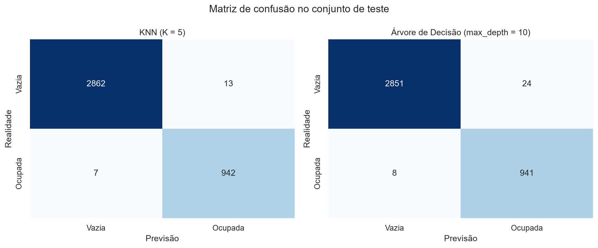
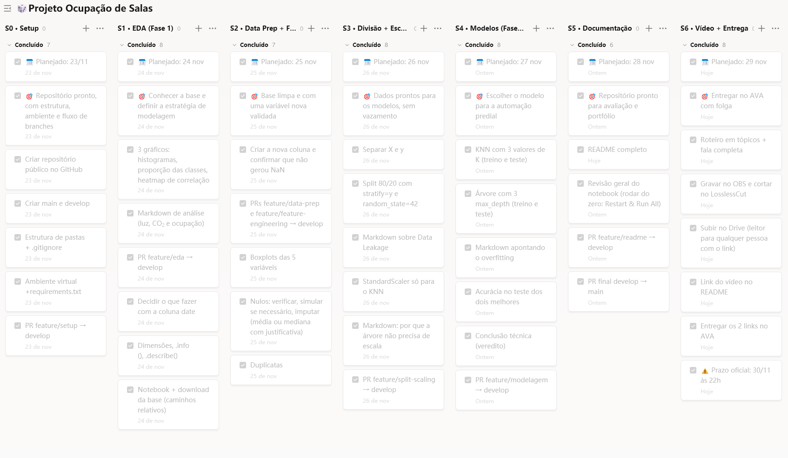

# Sensores IoT: Ocupação das Salas

Pipeline de Machine Learning que prevê se uma sala está **ocupada ou vazia** a partir de sensores ambientais IoT, para apoiar o desligamento automático de ar-condicionado (HVAC) e iluminação e reduzir o consumo de energia.

> **Resultado:** o modelo KNN identificou a ocupação das salas com **99,48% de acurácia** em dados novos, com apenas 13 casos de ar-condicionado ligado em sala vazia em 3.824 medições.



---

## Contexto e problema

Um complexo industrial e tecnológico conta com sensores ambientais instalados em salas técnicas e escritórios. O objetivo é prever, em tempo real, se cada ambiente está ocupado ou desocupado, para que o sistema de automação predial desligue o ar-condicionado e a luz quando não houver ninguém na sala.

A variável alvo é binária:

- `Occupancy = 1`: sala ocupada
- `Occupancy = 0`: sala desocupada

## Objetivo

Construir um pipeline completo de Ciência de Dados (análise exploratória, limpeza, criação de variável, divisão dos dados, padronização, ajuste de hiperparâmetros e avaliação) e comparar dois modelos de classificação, **KNN** e **Árvore de Decisão**, para escolher o mais adequado ao sistema.

## Base de dados

**Occupancy Detection Dataset**, do UCI Machine Learning Repository.

| Variável | Descrição |
|---|---|
| `date` | Data e hora da medição |
| `Temperature` | Temperatura do ambiente (°C) |
| `Humidity` | Umidade relativa do ar (%) |
| `Light` | Luminosidade (Lux) |
| `CO2` | Concentração de dióxido de carbono (ppm) |
| `HumidityRatio` | Razão de umidade, derivada da umidade e da temperatura |
| `Occupancy` | Variável alvo (0 = desocupada, 1 = ocupada) |

A base completa tem **20.560 medições**, resultado da união dos três arquivos do dataset original (`datatraining.txt`, `datatest.txt` e `datatest2.txt`).

## Ferramentas

- **Python** (ambiente virtual `venv`)
- **pandas** e **NumPy**: leitura e manipulação dos dados
- **Matplotlib** e **Seaborn**: gráficos
- **scikit-learn**: divisão dos dados, padronização, modelos e métricas
- **Jupyter Notebook** no **VS Code**
- **Git** e **GitHub**: versionamento com fluxo de branches
- **TickTick**: planejamento das Sprints em quadro Kanban

## Estrutura do repositório

```
ocupacao_salas_ml/
├── data/
│   ├── raw/                     # arquivos originais da UCI (baixados pelo notebook, não versionados)
│   ├── processed/
│   ├── external/
│   └── occupancy_completo.csv   # base completa (3 arquivos unidos)
├── docs/
│   └── kanban_sprints.png       # quadro Kanban do planejamento
├── notebooks/
│   └── analise_ocupacao.ipynb   # notebook principal, com as 7 fases
├── reports/
│   └── figures/                 # gráficos gerados pelo notebook
├── src/
├── .gitignore
├── requirements.txt
└── README.md
```

## Como executar

1. Clonar o repositório:
```bash
git clone https://github.com/MatheusCapri/ocupacao_salas_ml.git
cd ocupacao_salas_ml
```

2. Criar e ativar o ambiente virtual:
```bash
python -m venv .venv

# Windows (Git Bash)
source .venv/Scripts/activate

# Linux ou macOS
source .venv/bin/activate
```

3. Instalar as dependências:
```bash
pip install -r requirements.txt
```

4. Abrir o notebook `notebooks/analise_ocupacao.ipynb` (no VS Code ou com `jupyter notebook`), selecionar o kernel do `.venv` e executar todas as células em ordem.

A base já está versionada em `data/occupancy_completo.csv`. Se o arquivo não existir, o notebook baixa os dados direto da UCI na primeira execução. Todos os caminhos são relativos, então o projeto roda em qualquer computador.

## Pipeline

| Fase | O que foi feito |
|---|---|
| **1. Análise Exploratória** | Dimensões, tipos de dados, resumo estatístico, histogramas, proporção das classes e mapa de correlação. Descarte da coluna `date`. |
| **2. Limpeza e Tratamento** | Remoção de 1.441 linhas duplicadas, simulação e imputação de dados ausentes (média e mediana) e análise de outliers com boxplots. |
| **3. Feature Engineering** | Criação da variável `razao_co2_luz = CO2 / (Light + 1)`. |
| **4. Divisão dos Dados** | Treino (80%) e teste (20%) com `stratify=y` e `random_state=42`. |
| **5. Escalonamento** | `StandardScaler` apenas nos dados do KNN (`fit_transform` no treino, `transform` no teste). |
| **6. Ajuste de Hiperparâmetros** | KNN com K = 1, 3, 5, 7 e 9. Árvore com `max_depth` = 3, 5, 10 e `None`. Identificação de overfitting. |
| **7. Avaliação e Veredito** | Acurácia e matriz de confusão no teste dos melhores modelos e escolha final. |

## Principais descobertas da análise exploratória

- **A luminosidade é o sinal mais forte de ocupação**, com correlação de 0,91 com `Occupancy`. O histograma de `Light` mostra dois grupos bem definidos: luz apagada (0 Lux) e luz acesa (entre 400 e 500 Lux).
- **Temperatura (0,56) e CO2 (0,50)** têm correlação moderada com a ocupação, coerente com o calor e a respiração das pessoas na sala.
- **A umidade relativa quase não se relaciona com a ocupação** (0,05) e é muito correlacionada com `HumidityRatio` (0,93).
- **As classes são desbalanceadas**: na base original, 76,9% das medições são de salas vazias e 23,1% de salas ocupadas.
- **Os sensores têm escalas muito diferentes** (`Light` vai de 0 a quase 1.700, enquanto `HumidityRatio` fica abaixo de 0,007), o que torna a padronização essencial para o KNN.


## Decisões técnicas

**Fonte dos dados.** A versão da base disponibilizada em planilha online apresentou erro de formatação: ao ser importada com configuração regional em português, o ponto decimal foi interpretado como separador de milhar. Valores de `HumidityRatio` como `0,0047` passaram a aparecer como números inteiros muito grandes, e várias temperaturas e umidades ficaram dez vezes maiores. Por isso, os dados foram baixados direto do repositório da UCI, que é a fonte original. A união dos três arquivos reproduz a base completa, com as mesmas 20.560 linhas.

**Coluna `date` descartada.** É uma coluna de texto, com um valor diferente por minuto, e o objetivo do sistema é prever a ocupação a partir das condições do ambiente, e não do horário da medição.

**Duplicadas removidas após o descarte de `date`.** Sem a data, 1.441 medições com valores idênticos em todos os sensores passaram a ser duplicadas. Elas correspondiam principalmente a períodos de sala vazia, com o ambiente estável. Após a remoção, a base ficou com **19.119 linhas** e a proporção de salas ocupadas subiu para cerca de **24,8%**.

**Nulos simulados em uma cópia.** A base não tinha valores ausentes. Para validar a etapa de tratamento, 200 valores de `Temperature` e 200 de `CO2` foram apagados em uma **cópia** da base:
- `Temperature` foi preenchida com a **média**, por ter distribuição quase simétrica (média 20,96 e mediana 20,79);
- `CO2` foi preenchido com a **mediana**, por ser fortemente assimétrico (média 703,37 e mediana 574,25).

A base usada nos modelos manteve os valores reais dos sensores.

**Outliers mantidos.** Os valores extremos de `CO2`, `Temperature` e `Light` representam situações reais (salas cheias e luz solar intensa), e não erros de medição. Removê-los apagaria exemplos importantes da classe minoritária.

**Nova variável `razao_co2_luz`.** Combina os dois sensores mais ligados à ocupação. O `+ 1` no denominador evita divisão por zero, já que mais da metade das medições tem `Light = 0`. A nova variável teve correlação de **-0,58** com `Occupancy`, mais forte, em valor absoluto, do que a do CO2 isolado.

**Divisão antes da padronização.** O `StandardScaler` foi ajustado apenas com os dados de treino, para evitar *Data Leakage*. A Árvore de Decisão usa os dados sem padronização, porque decide com base em uma variável de cada vez e não é afetada pela diferença de escala.

## Resultados

### Ajuste de hiperparâmetros (acurácia)

**KNN**

| K | Treino | Teste |
|---|---|---|
| 1 | 100,00% | 99,50% |
| 3 | 99,59% | 99,45% |
| **5** | **99,46%** | **99,48%** |
| 7 | 99,35% | 99,42% |
| 9 | 99,23% | 99,32% |

**Árvore de Decisão**

| max_depth | Treino | Teste |
|---|---|---|
| 3 | 98,92% | 98,85% |
| 5 | 99,03% | 98,85% |
| **10** | **99,63%** | **99,16%** |
| None | 100,00% | 99,16% |

Houve **overfitting** com **K = 1** e com **`max_depth = None`**: os dois modelos acertaram 100% do treino, sinal de que "decoraram" os exemplos. A árvore sem limite de profundidade não teve nenhum ganho no teste em relação à árvore com `max_depth = 10`.

### Avaliação final no teste (3.824 medições)

| | KNN (K = 5) | Árvore (max_depth = 10) |
|---|---|---|
| **Acurácia** | **99,48%** | 99,16% |
| Falsos Positivos (sala vazia prevista como ocupada) | **13** | 24 |
| Falsos Negativos (sala ocupada prevista como vazia) | **7** | 8 |
| Total de erros | **20** | 32 |

### Veredito

**O modelo recomendado é o KNN com K = 5.** Ele teve a maior acurácia, cometeu menos erros no total e quase metade dos Falsos Positivos da árvore, o que significa menos desperdício de energia com ar-condicionado e luz ligados em salas vazias. Nos Falsos Negativos, os dois modelos ficaram praticamente empatados.

Os dois modelos ficaram muito acima da referência mínima de cerca de 75%, que é a acurácia de um modelo que responde sempre "sala vazia".

## Fluxo de branches

| Branch | Objetivo |
|---|---|
| `main` | Versão final do projeto |
| `develop` | Integração das funcionalidades durante o desenvolvimento |
| `feature/setup` | Estrutura de pastas, `.gitignore` e `requirements.txt` |
| `feature/eda` | Fase 1: análise exploratória |
| `feature/data-prep` | Fase 2: limpeza e tratamento de dados |
| `feature/feature-engineering` | Fase 3: criação da variável `razao_co2_luz` |
| `feature/split-scaling` | Fases 4 e 5: divisão dos dados e padronização |
| `feature/modelagem` | Fases 6 e 7: ajuste de hiperparâmetros e avaliação final |
| `feature/readme` | Documentação do projeto |
| `feature/ajustes-finais` | Figuras, matriz de confusão em mapa de calor, Kanban e ajustes finais |

Cada branch foi criada a partir da `develop` e integrada por Pull Request, sem exclusão da branch após o merge.

## Planejamento em Sprints

As tarefas foram organizadas em um quadro Kanban no TickTick, com uma coluna por Sprint, o período planejado e o objetivo de cada uma.

| Sprint | Objetivo | Planejado | Real |
|---|---|---|---|
| S0 Setup | Repositório pronto, com estrutura, ambiente e fluxo de branches | 23/11 | 23/11 |
| S1 EDA | Conhecer a base e definir a estratégia de modelagem | 24/11 | 24/11 |
| S2 Data Prep + Feature | Base limpa e com uma variável nova validada | 25/11 | 25/11 |
| S3 Divisão + Escala | Dados prontos para os modelos, sem vazamento | 26/11 | 26/11 |
| S4 Modelos | Escolher o modelo para a automação predial | 27/11 | 27/11 |
| S5 Documentação | Repositório pronto para avaliação e portfólio | 28/11 | 27/11 |
| S6 Vídeo + Entrega | Entregar no AVA com folga | 29/11 | [ ] |



**Retrospectiva:** todas as Sprints foram concluídas dentro do período planejado, e as duas últimas foram adiantadas em um dia. O principal imprevisto foi o erro de formatação na base em planilha, resolvido no primeiro dia com o download direto da UCI, sem atrasar o cronograma.

## Melhorias futuras

- **Usar a data e a hora**: extrair variáveis como hora do dia e dia da semana, que podem ter relação com a ocupação.
- **Validação cruzada**: escolher K e `max_depth` com *cross-validation*, em vez de uma única divisão entre treino e teste.
- **Outras métricas**: acompanhar Recall, Precisão e F1-Score, dando mais peso aos Falsos Negativos, que desligariam o sistema com pessoas na sala.
- **Salvar o modelo**: guardar o KNN e o `StandardScaler` com a biblioteca Joblib, para usar em produção.
- **Testar outros modelos**, como Random Forest.
- **Avaliar a redundância** entre `Humidity` e `HumidityRatio`.
- **Monitorar o modelo em produção**, para detectar mudanças no padrão dos dados (*Data Drift*), como salas com mais luz natural.
- **Criar uma interface simples** (por exemplo, com Streamlit) para demonstrar a previsão a partir de valores dos sensores.

## Vídeo de apresentação

[ ] Link do vídeo

## Fonte dos dados

Candanedo, L. (2016). *Occupancy Detection* [Dataset]. UCI Machine Learning Repository. https://archive.ics.uci.edu/dataset/357/occupancy+detection

## Autor

**Matheus Capri**

- LinkedIn: [linkedin.com/in/matheus-capri-nery](https://www.linkedin.com/in/matheus-capri-nery)
- GitHub: [github.com/MatheusCapri](https://github.com/MatheusCapri)
